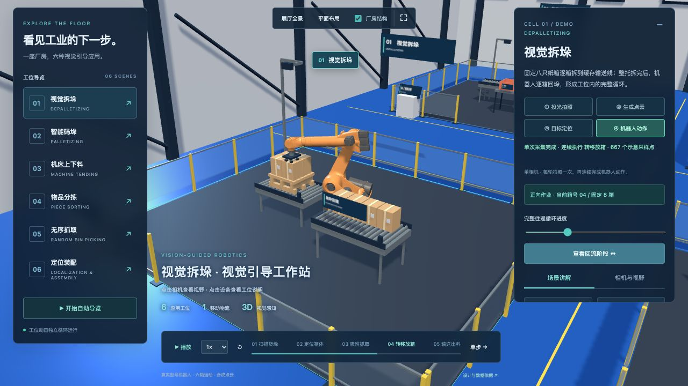

# VISION FLOW · 3D 视觉机器人工业展厅

浏览器里的企业工业视觉展厅：六个机器人工作站、单相机采集与表面点云、拆码垛闭环、中央通道 AGV，以及可暂停和逐步查看的工作流程。

[在线展厅](https://vision-flow-lab.thomaslwycityu.chatgpt.site/)（目前沿用原站访问权限）



## 本地运行

网页使用本地 Three.js 模块和模型，无需安装前端依赖或构建。需要 Python 3；检查脚本另需 Node.js 20 或更新版本。

```bash
python3 -m http.server 8080 --bind 127.0.0.1 --directory dist
```

打开 <http://127.0.0.1:8080/>。请通过 HTTP 访问，以便加载模型和模块。

```bash
# 两项检查均通过后退出
npm run check
```

`npm start` 也可启动上面的本地服务器；不需要先运行 npm install。

## 仓库内容

| 目录 | 内容 |
| --- | --- |
| `dist/` | 可直接部署到静态托管的完整网页、Three.js、本地机器人模型与许可证 |
| `checks/` | 运动、机床外壳、箱体连续性、单次采集和表面投影检查 |
| `robot-assets/` | 固定版本原始 DAE/URDF、来源哈希与 GLB 转换脚本 |
| `animation/vision-flow/` | 早期单工位的 Blender 生成脚本和 15 秒动画交付文件 |
| `docs/screenshots/` | 当前单相机版本截图 |

## 动画与模型源文件

- [15 秒概念动画 MP4](animation/vision-flow/delivery/Vision_Flow_15s.mp4)
- [可编辑 Blender 工程](animation/vision-flow/delivery/Vision_Flow.blend)
- [动画使用说明](animation/vision-flow/delivery/使用说明.md)
- [模型版本和许可](dist/models/README.txt)

动画是早期单工位概念样片，采用程序模型；网页展厅采用 KUKA 和 ABB 的社区模型，两者对应不同阶段的成果。动画生成脚本需 Blender、Pillow、NumPy、FFmpeg 和可用的中文字体；默认字幕字体为 macOS 系统字体。

机器人原始文件已经包含在仓库中；如需恢复或重新转换：

```bash
python3 robot-assets/download_models.py
python3 -m pip install -r robot-assets/requirements.txt
python3 robot-assets/convert_models.py
python3 robot-assets/package_provenance.py
```

## 来源与范围

网页以已完成的单相机版本为基准（原展厅源码提交 `9be13ef3f65351aaee988093031fe41d96685234`），不包含托管平台配置、本机缓存、访问凭据或重复的渲染备份。

第三方模型和 Three.js 保留各自上游许可，见 [THIRD_PARTY_NOTICES.md](THIRD_PARTY_NOTICES.md)。本仓库未为这些素材另行授予统一许可。

---

## 展厅实现说明

在原有拆垛实验室上扩展的实时三维展厅。首页 `dist/index.html`；保留的单工位实验室 `dist/workcell.html`。

## 展示内容

六个独立循环的概念工位：视觉拆垛、智能码垛、机床上下料、物品分拣、无序抓取、定位装配。AGV在中央通道独立演示运输。

参考用户提供的厂房与应用照片，重新搭建蓝色地坪、深色钢结构、白色墙面、黄色围栏、讲解台和工位。机器人使用 ROS-Industrial 社区真实型号几何，厂房与周边设备仍为概念场景。

## 交互

- 点击导航、工位标签或模型进入近景；点击相机进入视觉详情。
- 全景、俯视、厂房结构开关、全屏展示。
- 自动导览每30秒切换工位；暂停、速度、流程跳转、单步控制。
- 每个工位的相机可调安装高度；示意视野、合成点云、运动轨迹开关。

## 数据边界

周边设备尺寸、相机视角、动作时长、零件及颜色分类均为演示设定。视野宽为工作距离×0.54，深为工作距离×0.42；未绑定具体相机型号。点云为合成数据，目标平面为工位预设参考平面。机器人按源 URDF 六轴旋转关节层级与角度限制驱动，采用阻尼最小二乘逆运动学，无工程级碰撞、安全或节拍校核。机床加工仅以开关门和动作阶段表达。AGV没有接入实际调度或与工位形成生产联锁。

## 维护

Three.js 0.180.0与OrbitControls本地保存在vendor中，许可证随附。场景与数据定义位于hall.js，界面样式位于hall.css。无需构建，可用静态HTTP服务器预览。

## 真实机器人模型

拆垛、码垛采用 KUKA KR 210 L150；其余四个工位采用 ABB IRB 4600-40/2.55。保留原始机器人尺寸，紧凑布局仅调整周边设备。原始 DAE 转为 GLB，关节参数单独保存；来源版本、原始文件哈希与许可说明位于 dist/models/。KUKA 上游根 LICENSE 与 package.xml 的许可声明不同，两者原样保留；ABB 为 Apache-2.0。

验证：`node checks/verify-motion.mjs`。拆垛与码垛各2400个采样覆盖完整240秒往返，检查固定8箱、箱体之间不相交、阶段交接与循环边界无跳变，以及关节限制和末端误差。机床上下料连续三轮、共4500个采样，使用GLB每段几何的保守定向包围盒，检查整臂及夹爪与机床外壳、门框、导轨和活动门的分离。AGV按车板、托盘和箱底接触面校核高度。这些展示场景回归检查不代表工程认证或真实设备安全验证。

## 工位内循环

拆垛、码垛各使用固定八只纸箱，在托盘与缓存输送线之间往返。每半轮8箱，完整往返的逻辑运动时间240秒；加入视觉采集等待后，实际演示268.8秒；不切换可见性，不复制、清空或重置箱子。详情页的循环进度条和“查看回流阶段”可检查整轮。机床增加前方开口、垂直门及导轨，机械臂退出后才关闭门；卸料位的工件在下一轮可见地送回料盘。

## 相机采集演示

六个工位共用视觉时序：每轮开始先进行一次1.8秒视觉采集，保持机器人和工件位置，依次展示投光曝光、表面点云生成和目标定位；随后连续执行原来的15秒动作，中间不再拍照。四个视觉阶段按钮可暂停查看，流程跳转与闭环滑杆保留正确时序。

投影网格从采集头向工位发射光线，点云取可见物体及地板的最近表面交点，随扫描进度逐步出现。透明光束、表面光斑和聚光灯用于解释投光过程，不代表某一真实相机的光学参数或测量结果。每个工位只保留一台原有主相机；拆垛、码垛和机床上下料不设置辅助相机或辅助支架。整轮动作复用这一次采集。

验证：`node checks/verify-vision.mjs` 检查采集期间的运动等待、循环时钟映射，以及箱面/地面的最近交点与遮挡。原有运动和机床外壳回归检查仍由 `node checks/verify-motion.mjs` 执行。
